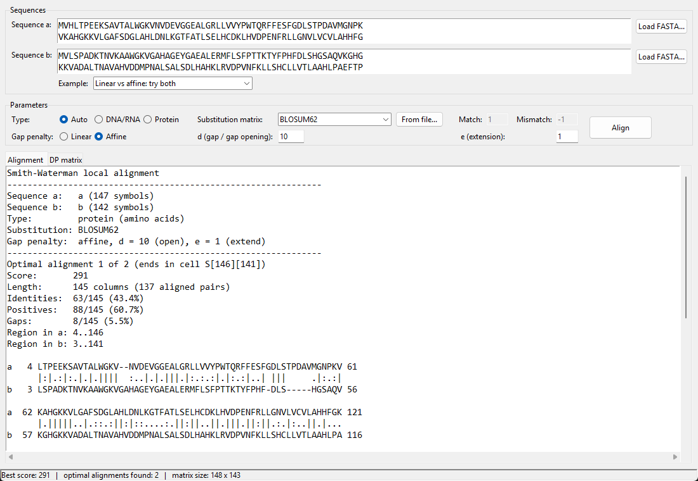

# Smith-Waterman Local Sequence Alignment

[](https://github.com/YUStulinu/Smith-Waterman_Algorithm/actions/workflows/tests.yml)


[](LICENSE)

> Romanian version: [README.ro.md](README.ro.md)

A pure-Python implementation of the **Smith-Waterman algorithm** for optimal local alignment of DNA, RNA and protein sequences, with **linear and affine gap penalties**, standard substitution matrices (BLOSUM, PAM, NUC.4.4), a command line interface and a Tkinter GUI that draws the dynamic programming matrix and explains how every cell was computed.

It was written as the exam project (topic 4) for the Bioinformatics course of my master's degree. The full report and the slides are in [`docs/`](docs/), in English and Romanian.



## Features

- **Local alignment by dynamic programming**: optimal score and alignment in O(n·m) time.
- **Linear gap penalty**: a run of k gaps costs `k·d`.
- **Affine gap penalty** (Gotoh's three matrices S, Ga, Gb): a run of k gaps costs `d + (k-1)·e`.
- **Substitution matrices chosen by sequence type**:
  - nucleotides: `IDENTITY` (your own match / mismatch scores), `TRANSITION_TRANSVERSION`, `NUC.4.4`
  - amino acids: `BLOSUM45`, `BLOSUM50`, `BLOSUM62`, `BLOSUM80`, `BLOSUM90`, `PAM30`, `PAM70`, `PAM250`
  - any other matrix from a file in NCBI format
- **Every optimal alignment** is reported when the best score is reached in several cells.
- **Statistics**: identities, positives, gaps and the aligned region in each sequence.
- **FASTA input**, automatic DNA/protein detection, RNA accepted (U is aligned as T).
- **GUI**: the DP matrix with the traceback path highlighted; click a cell to see its recurrence with the actual values. The alignment runs in a background thread, so the window stays responsive on long sequences.
- **No dependencies**: only the Python standard library (3.10 or newer).

## Quick start

```bash
git clone https://github.com/YUStulinu/Smith-Waterman_Algorithm.git
cd Smith-Waterman_Algorithm
python gui.py
```

### Command line

The textbook example, with the DP matrix printed:

```bash
python main.py --seq1 ATCTGA --seq2 TGCA --gap-open 2 --show-matrix
```

```
Score:       2
Region in a: 4..5
Region in b: 1..2

a 4 TG 5
    ||
b 1 TG 2

Score matrix S (traceback path in brackets):
           T   G   C   A
       0   0   0   0   0
  A    0   0   0   0   1
  T    0   1   0   0   0
  C  [0]   0   0   1   0
  T    0 [1]   0   0   0
  G    0   0 [2]   0   0
  A    0   0   0   1   1
```

Two proteins from FASTA files, with BLOSUM62 and affine gaps:

```bash
python main.py --fasta1 examples/hbb_human.fasta --fasta2 examples/hba_human.fasta --matrix BLOSUM62 --gap affine --gap-open 10 --gap-extend 1
```

```
Score:       291
Identities:  63/145 (43.4%)
Positives:   88/145 (60.7%)

a   4 LTPEEKSAVTALWGKV--NVDEVGGEALGRLLVVYPWTQRFFESFGDLSTPDAVMGNPKV 61
      |:|.:|:.|.|.||||  :..|.|.|||.|:.:.:|.|:.:|..| |||     .|:.:|
b   3 LSPADKTNVKAAWGKVGAHAGEYGAEALERMFLSFPTTKTYFPHF-DLS-----HGSAQV 56
...
```

Run `python main.py` with no arguments for an interactive mode, `python main.py --list-matrices` for the matrices and `python main.py --help` for every option.

| Option | Meaning |
|---|---|
| `--seq1`, `--seq2` | sequences typed directly |
| `--fasta1`, `--fasta2` | sequences from FASTA files |
| `--type auto\|dna\|protein` | sequence type (default: detected) |
| `--matrix NAME` | substitution matrix |
| `--matrix-file FILE` | substitution matrix from a file (NCBI format) |
| `--match`, `--mismatch` | scores for the `IDENTITY` matrix (default 1 and -1) |
| `--gap linear\|affine` | gap model (default linear) |
| `--gap-open`, `-d` | d: penalty per gap (linear) or for opening a gap (affine) |
| `--gap-extend`, `-e` | e: penalty for extending a gap (affine only) |
| `--show-matrix` | print the matrices S (and Gb, Ga for affine gaps) |
| `--show-substitution` | print the substitution matrix |
| `--all` | print every optimal alignment |

Penalties are positive numbers that are subtracted from the score.

### As a library

```python
from smith_waterman import get_matrix, smith_waterman

result = smith_waterman("HEAGAWGHEE", "PAWHEAE", get_matrix("BLOSUM50"), gap_open=8)
alignment = result.alignment
print(result.best_score)                         # 28
print(alignment.aligned_a, alignment.aligned_b)  # AWGHE AW-HE
```

Pass `gap_extend=...` to use affine gaps.

## The algorithm

With a linear gap penalty `d`, the score matrix is filled with

```
S(i, 0) = S(0, j) = 0
S(i, j) = max{ 0,
               S(i-1, j-1) + M(a[i], b[j]),
               S(i-1, j) - d,
               S(i, j-1) - d }
```

The alignment ends in the cell with the highest value and is rebuilt backwards until a cell with value 0 is reached. The `0` option is what makes the alignment local. With an affine penalty, two more matrices track alignments that end with a gap in `a` (Ga) or in `b` (Gb), so opening and extending a gap can cost different amounts while the running time stays O(n·m). The [report](docs/Report_Smith-Waterman.pdf) explains both variants in detail.

## Validation

- The examples from the course and from Durbin et al. (1998) are reproduced exactly.
- On short sequences, the score is compared with an exhaustive search over every local alignment.
- The scores were compared with Biopython's `PairwiseAligner` (local mode) on 3300 random DNA and protein pairs, with linear and affine gaps, and no difference was found.
- 25 unit tests run on every push (see the badge above):

```bash
python -m unittest discover -s tests -v
```

## Project layout

```
main.py                    command line entry point
gui.py                     Tkinter GUI
demo.py                    the examples used in the report
benchmark.py               running time vs. sequence length
smith_waterman/
    core.py                the algorithm (linear and affine) and the traceback
    matrices.py            substitution matrices
    sequences.py           FASTA reading, cleaning and validation
    formatting.py          text output
    cli.py                 command line options and interactive mode
    data/                  BLOSUM, PAM and NUC.4.4 matrices (NCBI format)
examples/                  FASTA test sequences
tests/                     unit tests
docs/
    Report_Smith-Waterman.docx / .pdf           report (English)
    Presentation_Smith-Waterman.pptx            slides (English)
    Referat_Smith-Waterman.docx / .pdf          report (Romanian)
    Prezentare_Smith-Waterman.pptx              slides (Romanian)
```

The `.vscode/launch.json` file has ready-made run configurations (GUI, CLI examples, demo, tests, benchmark) for VS Code.

## References

- Smith T.F., Waterman M.S. (1981). Identification of common molecular subsequences. *Journal of Molecular Biology*, 147(1), 195–197.
- Gotoh O. (1982). An improved algorithm for matching biological sequences. *Journal of Molecular Biology*, 162(3), 705–708.
- Durbin R., Eddy S., Krogh A., Mitchison G. (1998). *Biological Sequence Analysis*. Cambridge University Press.

The full list of 21 references is in the report.

## License

[MIT](LICENSE)
